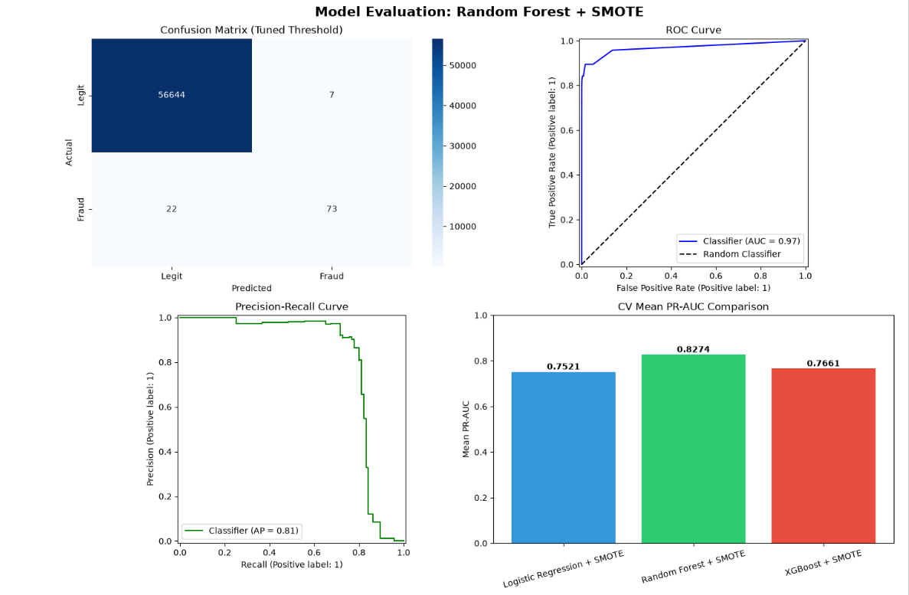
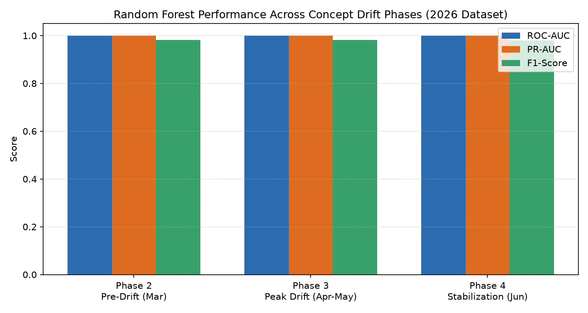
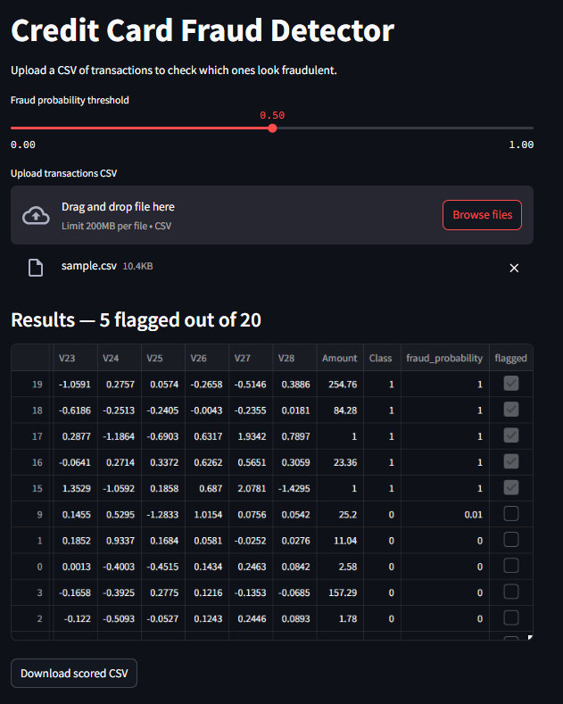

# 💳 Credit Card Fraud Detection Using Machine Learning


[](https://credit-card-fraud-detection.streamlit.app/)


> A machine learning project for detecting fraudulent credit card transactions using supervised learning techniques. This project addresses the severe class imbalance using **SMOTE**, evaluates multiple classification models, and selects the best-performing model based on **Precision-Recall AUC (PR-AUC)**.


---

## 📑 Table of Contents

- [📖 Project Overview](#-project-overview)
- [📌 Project Workflow](#-project-workflow)
- [📂 Dataset](#-dataset)
- [🛠 Technologies Used](#-technologies-used)
- [🔍 Exploratory Data Analysis (EDA)](#-exploratory-data-analysis-eda)
- [⚙️ Data Preprocessing](#️-data-preprocessing)
- [🤖 Machine Learning Models](#-machine-learning-models)
- [📈 Model Evaluation](#-model-evaluation)
- [🏆 Cross-Validation Results](#-cross-validation-results)
- [📊 Test Set Performance](#-test-set-performance)
- [📷 Results](#-results)
- [💡 Key Findings](#-key-findings)
- [📁 Repository Structure](#-repository-structure)
- [📓 Installation](#-installation-notebook)
- [🚀 Try it yourself](#-try-it-yourself-web-app)
- [🔮 Future Improvements](#-future-improvements)
- [🎯 Conclusion](#-conclusion)
- [👨‍💻 Author](#-author)

---
## 📊 Project Overview

This project develops an end-to-end fraud detection pipeline using Python and Scikit-learn. It follows the complete machine learning workflow, from exploratory data analysis and preprocessing to model training, evaluation, and comparison.

Since fraudulent transactions represent only **0.17%** of the dataset, traditional accuracy is not a reliable performance metric. Therefore, this project focuses on **Precision-Recall AUC (PR-AUC)** and **ROC-AUC** to evaluate model performance.

---

## 📌 Project Workflow

```
Data Exploration
        │
        ▼
Data Cleaning
        │
        ▼
Exploratory Data Analysis (EDA)
        │
        ▼
Data Preprocessing
        │
        ▼
Machine Learning Pipelines
        │
        ▼
Cross Validation
        │
        ▼
Model Selection
        │
        ▼
Test Set Evaluation
        │
        ▼
Conclusion
```

---

## 📂 Dataset

The project uses the **Credit Card Fraud Detection Dataset**, containing real-world credit card transactions made by European cardholders.

| Property | Value |
|----------|-------|
| Total Transactions | **284,807** |
| Features | **30** |
| Target | **Class** |
| Legitimate Transactions | **284,315** |
| Fraudulent Transactions | **492 (0.17%)** |

### Features

- **Time** – Seconds elapsed between transactions
- **V1 – V28** – PCA-transformed anonymous features
- **Amount** – Transaction amount
- **Class** – Target variable (0 = Legitimate, 1 = Fraud)

---

## 🛠 Technologies Used

- Python
- NumPy
- Pandas
- Matplotlib
- Seaborn
- Scikit-learn
- Imbalanced-learn (SMOTE)
- XGBoost
- Jupyter Notebook
- Streamlit
- Joblib

---

## 🔍 Exploratory Data Analysis (EDA)

The exploratory analysis includes:

- Dataset overview
- Statistical summary
- Missing value inspection
- Duplicate record removal
- Class imbalance analysis
- Transaction amount distribution
- Transaction time distribution
- Correlation heatmap
- Boxplots
- Countplots

---

## ⚙️ Data Preprocessing

The following preprocessing steps were applied before model training:

- Feature/target separation
- Stratified train-test split (80/20)
- Standardization using **StandardScaler**
- Class imbalance handling using **SMOTE**
- Pipeline implementation to prevent data leakage

---

## 🤖 Machine Learning Models

Three supervised learning algorithms were evaluated:

- Logistic Regression
- Random Forest
- XGBoost

Each model was implemented using an **Imbalanced-learn Pipeline**, consisting of:

```
StandardScaler
        │
        ▼
SMOTE
        │
        ▼
Classifier
```

---

## 📈 Model Evaluation

Models were compared using **3-Fold Stratified Cross-Validation**.

### Evaluation Metrics

- Precision
- Recall
- F1-Score
- ROC-AUC
- Precision-Recall AUC (Average Precision)

> Since this dataset is highly imbalanced, **PR-AUC** was selected as the primary metric for model comparison.

---

## 🏆 Cross-Validation Results

| Model | Mean PR-AUC |
|--------|------------:|
| Logistic Regression + SMOTE | **0.7521** |
| Random Forest + SMOTE | **0.8274** |
| XGBoost + SMOTE | **0.7661** |

## ✅ Best Model

**Random Forest + SMOTE**

---

## 📊 Test Set Performance

| Metric | Score |
|---------|-------|
| ROC-AUC | **0.9694** |
| PR-AUC | **0.8115** |

### Classification Report

| Class | Precision | Recall | F1-score |
|-------|----------:|-------:|----------:|
| Legitimate | 1.00 | 1.00 | 1.00 |
| Fraud | **0.91** | **0.77** | **0.83** |

---

## 📷 Results

### 1. European PCA Dataset — Model Evaluation



### 2. Banking Behavioral Drift Dataset (2026) — Temporal Evaluation

To test real-world generalization beyond anonymized PCA features, a second pipeline (`StandardScaler + Balanced Random Forest`) was trained strictly on **Phase 1 (Jan–Feb)** using **34 leakage-free real-time banking features** and evaluated on future unseen months:

| Drift Phase | Rows | ROC-AUC | PR-AUC | Precision | Recall | F1-Score |
|-------------|-----:|--------:|-------:|----------:|-------:|---------:|
| Phase 2: Pre-Drift Validation (Mar) | 20,445 | **1.0000** | **0.9997** | 0.9664 | 0.9974 | 0.9817 |
| Phase 3: Peak Drift (Apr–May) | 40,586 | **1.0000** | **0.9997** | 0.9646 | 0.9984 | 0.9812 |
| Phase 4: Stabilization (Jun) | 19,836 | **1.0000** | **0.9998** | 0.9608 | 0.9984 | 0.9793 |

Top real-world fraud signals learned: `amount_last_1h`, `transactions_last_24h`, `prior_dispute_ratio_90d`, `merchant_velocity_24h`, `transactions_last_1h`, and `pin_retry_count_24h`.



---

## 💡 Key Findings

- **Extreme Imbalance (ULB Dataset):** Fraudulent transactions represent only **0.17%** of all observations; SMOTE inside an `imblearn` pipeline prevented data leakage and achieved **0.8115 Test PR-AUC** and **0.9694 ROC-AUC**.
- **Real-World Behavioral Signals & Temporal Split (2026 Dataset):** Excluding post-transaction/dispute columns prevents target leakage, and velocity/dispute features (`amount_last_1h`, `transactions_last_24h`, `prior_dispute_ratio_90d`) stay highly predictive across unseen drift phases.
- **Business-Aligned Decisions:** Dynamic threshold tuning paired with a Cost-Benefit Optimizer lets risk teams maximize net financial savings rather than optimizing raw accuracy.

---

## 📁 Repository Structure

```text
credit_card_fraud_project/
├── app/
│   ├── app.py                            # Multi-model Streamlit app (SHAP + Cost-Benefit + Live Trainer)
│   ├── requirements.txt                  # App dependencies
│   ├── sample.csv                        # Sample data for ULB PCA model
│   └── sample_drift.csv                  # Sample data for 2026 Behavioral Drift model
│
├── model/
│   ├── fraud_pipeline.joblib             # Trained ULB PCA pipeline (Scaler + SMOTE + RF)
│   └── drift_fraud_pipeline.joblib       # Trained 2026 Behavioral pipeline (Scaler + Balanced RF)
│
├── notebook/
│   ├── credit_card_fraud_detection.ipynb # ULB European PCA workflow
│   └── drift_fraud_detection.ipynb       # 2026 Behavioral Drift temporal workflow
│
├── data/
│   └── DATASET.md                        # Dataset links, schemas & temporal split details
│
├── images/
│   ├── app_screenshot.png                # App demo screenshot
│   ├── credit_card_fraud_detection_thumbnail.png  # README banner
│   ├── model_evaluation.png              # ULB evaluation dashboard
│   └── drift_evaluation.png              # 2026 Concept Drift phase evaluation chart
│
├── README.md                             # Project documentation
├── requirements.txt                      # Notebook & app dependencies
├── LICENSE                               # MIT License
└── .gitignore                            # Git ignore rules
```

---

## 📓 Installation (Notebook)

Clone the repository
```bash
git clone https://github.com/MOHITPUNIA70155/credit_card_fraud_project.git
```

Navigate to the project
```bash
cd credit_card_fraud_project
```

Install dependencies
```bash
pip install -r requirements.txt
```

Launch Jupyter Notebook
```bash
jupyter notebook
```

Open `notebook/credit_card_fraud_detection.ipynb`

---

## 🚀 Try it yourself (Web App)



An interactive Streamlit app lets you upload a CSV of transactions (or use the built-in sample dataset) to get:

- **Dynamic Fraud Probability & Risk Tiers** with an adjustable decision threshold
- **Cost-Benefit Calculator & Threshold Optimizer** simulating net financial savings vs. investigation costs across thresholds
- **SHAP Explainability & Feature Importance** (global feature impact and per-transaction local SHAP explanations)

Install app dependencies
```bash
pip install -r app/requirements.txt
```

Launch the app (works from the project root or inside `app/`)
```bash
streamlit run app/app.py
```

Upload a CSV of transactions (see `app/sample.csv` for the expected format).

---

## 🔮 Future Improvements

Possible extensions include:

- Hyperparameter tuning using GridSearchCV or Optuna
- Cost-sensitive learning
- Deep learning models for fraud detection
- Real-time fraud detection deployment (Kafka / FastAPI)

---

## 🎯 Conclusion

This project demonstrates a complete machine learning workflow for detecting fraudulent credit card transactions. Through exploratory data analysis, careful preprocessing, and robust model evaluation, multiple classifiers were compared using Stratified Cross-Validation and Precision-Recall AUC.

Among the evaluated models, **Random Forest combined with SMOTE** achieved the strongest overall performance, obtaining a **Cross-Validation PR-AUC of 0.8274**, a **Test ROC-AUC of 0.9694**, and a **Test PR-AUC of 0.8115**. These results indicate that the model effectively distinguishes fraudulent transactions while maintaining strong precision and recall despite the severe class imbalance.

To make the model accessible beyond the notebook, the trained pipeline was deployed as an **interactive Streamlit web app** featuring dynamic threshold tuning, **SHAP explainability**, and a **Cost-Benefit Threshold Optimizer**.

---

## 👨‍💻 Author

**Mohit Punia** ([GitHub](https://github.com/MOHITPUNIA70155))

Machine Learning • Data Science • Python

> ⭐ If you found this project useful, consider giving it a star!
